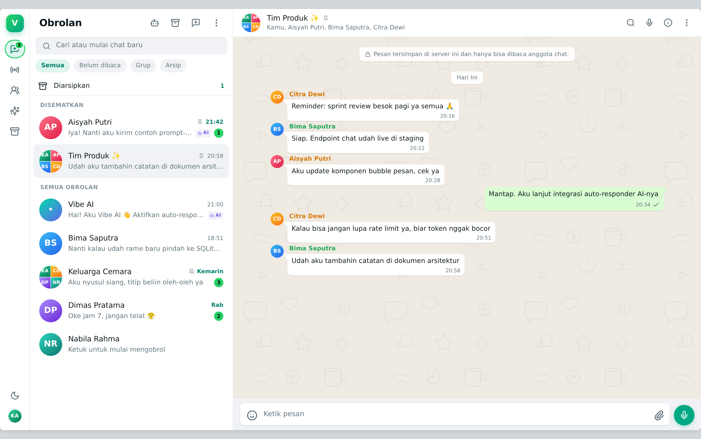
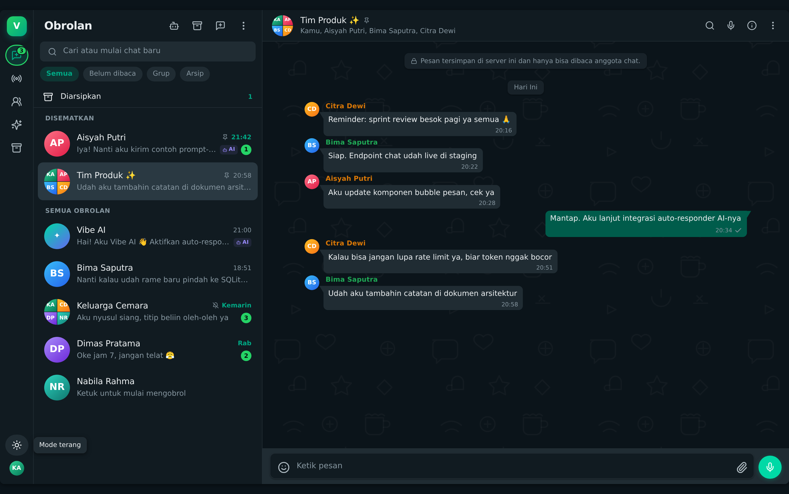
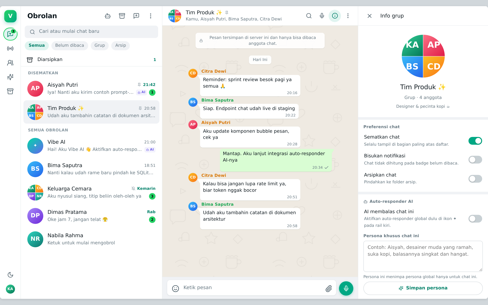
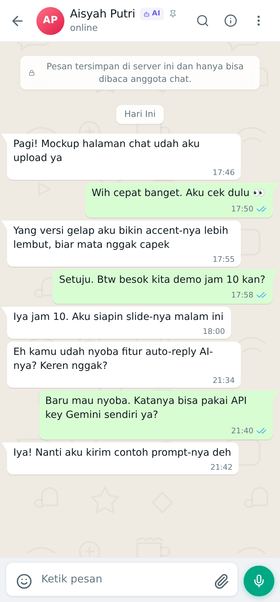

# VibeChat

> Klon aplikasi chat bergaya WhatsApp yang berjalan **tanpa database** — semua data disimpan di satu berkas JSON — dengan **auto-responder AI** yang bisa memakai **API key Gemini** atau **endpoint AI pribadi** (OpenAI-compatible).

Dibangun dengan Next.js 15 (App Router) + React 19 + TypeScript. Tidak perlu Postgres, MySQL, atau MongoDB. Cukup satu proses Node dan satu folder data.

---

## 0. Tampilan

Klon visual 1:1 alur kerja WhatsApp Web (redesign 2025) dengan penyempurnaan sendiri:

| | |
| --- | --- |
|  |  |
| Mode terang — rail navigasi, header 60px, wallpaper doodle, bubble ber-ekor | Mode gelap — palet `#0b141a / #202c33 / #005c4b`, kontras lebih rendah |

| Info chat | Mobile |
| --- | --- |
|  |  |

**Yang direplikasi dari WhatsApp Web:** rail navigasi kiri (Obrolan/Status/Saluran/Arsip), header statis 60px,
search bar pil, chip filter, baris chat 72px dengan kolase avatar grup 2×2, centang biru `#53bdeb`,
bubble keluar `#d9fdd3` / `#005c4b` dengan ekor, chip tanggal, wallpaper doodle, composer pil dengan
emoji/attachment/kirim, panel info chat 400px, indikator "mengetik", dan layout responsif satu-kolom di ponsel.

**Penyempurnaan sendiri:** tema gelap/terang yang bisa diganti manual (tersimpan di `localStorage`, tanpa flash),
aksen ungu `#6c5ce7` + label `AI` untuk pesan hasil auto-responder, panel pengaturan AI, pencarian dalam chat
dengan hit-count & sorotan, tooltip rail, serta emoji berwarna yang tetap tampil di Linux minimal
(webfont Noto Color Emoji, diunduh hanya bila sistem tidak punya glyph emoji).

---

## 1. Fitur

### Percakapan
- Chat pribadi (DM) dan grup dengan anggota bebas.
- Kirim teks, emoji, dan gambar (upload hingga 8 MB: PNG/JPG/WEBP/GIF).
- Balas pesan (quote), hapus pesan untuk diri sendiri atau untuk semua orang.
- Status terkirim/dibaca (centang ganda biru), penanda "AI" pada pesan hasil auto-reply.
- Daftar chat dengan pencarian, filter **Semua / Belum dibaca / Grup / Arsip**, baris "Diarsipkan", badge belum dibaca.
- Rail navigasi: Obrolan, Status, Saluran, Asisten AI, Arsip, ganti tema, profil.
- Pencarian **di dalam chat** dengan jumlah hasil + navigasi hasil sebelumnya/berikutnya dan sorotan bubble.
- Tema terang/gelap manual (default mengikuti sistem).
- Sematkan (pin), bisukan, dan arsipkan chat.
- Indikator "sedang mengetik" untuk balasan AI, plus auto-scroll dan tombol ke pesan terbaru.
- Responsif: sidebar + panel chat di desktop, tampilan penuh dengan tombol kembali di ponsel.

### Akun
- Registrasi & login dengan nomor telepon + password.
- Password di-hash dengan `scrypt` (bukan plain text), sesi ditandatangani HMAC di cookie `httpOnly`.
- Akun baru otomatis mendapat sapaan dari Vibe AI.

### Auto-responder AI (fitur unggulan)
- **Dua mode provider:**
  - **Google Gemini** — endpoint `generativelanguage.googleapis.com` (default model `gemini-2.5-flash`).
  - **Endpoint kustom OpenAI-compatible** — OpenAI, OpenRouter, Groq, Together, Ollama, LM Studio, dsb.
- **Persona global** (system prompt) + **persona khusus per chat**.
- Pengaturan temperature, batas token, jumlah pesan konteks, dan jeda "mengetik" agar balasan terasa manusiawi.
- **Aktif/nonaktif global** dan **per chat**.
- Perilaku berbeda per tipe chat:
  - **DM** → balasan dikirim **atas nama lawan bicara**, meniru persona yang kamu tulis.
  - **Grup** → balasan dikirim sebagai akun sistem **Vibe AI**.
- Tombol **Uji koneksi** di pengaturan untuk memvalidasi key/endpoint sebelum dipakai.
- Kegagalan provider tampil sebagai pesan sistem di chat, bukan error senyap.
- API key **tidak pernah dikirim utuh** ke browser (hanya `hasApiKey` + preview 3+4 karakter).

---

## 2. Menjalankan

```bash
npm install
cp .env.example .env      # opsional
npm run dev               # http://localhost:3000
```

Build produksi:

```bash
npm run build && npm start
```

### Akun demo (dibuat otomatis pada run pertama)

| Nama | Nomor | Password |
| --- | --- | --- |
| Kamu (owner) | `628111111111` | `vibe123` |
| Aisyah Putri | `6281200000002` | `vibe123` |
| Bima Saputra | `6281200000003` | `vibe123` |

Semua akun seed memakai password `vibe123`. Ada 7 pengguna, 7 chat (DM + grup), dan riwayat pesan contoh.

### Reset data

```bash
npm run db:reset   # hapus data/db.json; seed dibuat ulang saat server start
```

---

## 3. Struktur proyek

```
Vibe-Chat/
├─ data/
│  └─ db.json                 # DATABASE (dibuat otomatis, di-gitignore)
├─ public/
│  └─ uploads/                # gambar hasil upload
├─ docs/                      # tangkapan layar UI
├─ scripts/
│  └─ reset-db.mjs            # reset/seed ulang
├─ tests/
│  └─ e2e.mjs                 # 23 uji end-to-end (Playwright) + provider AI tiruan
├─ src/
│  ├─ app/
│  │  ├─ layout.tsx           # root layout + metadata
│  │  ├─ page.tsx             # server component: cek sesi → AuthGate / ChatApp
│  │  ├─ globals.css          # design system: token warna, wallpaper, light/dark, responsif
│  │  └─ api/
│  │     ├─ auth/login|register|logout/
│  │     ├─ me/               # profil sendiri (GET/PATCH)
│  │     ├─ users/            # direktori kontak
│  │     ├─ chats/            # list + buat chat (GET/POST)
│  │     │  └─ [id]/
│  │     │     ├─ route.ts    # detail, patch (pin/mute/arsip/AI), hapus
│  │     │     ├─ messages/   # kirim pesan
│  │     │     ├─ read/       # tandai dibaca
│  │     │     └─ typing/     # status AI mengetik
│  │     ├─ messages/[id]/    # hapus pesan (scope=me|all)
│  │     ├─ settings/ai/      # baca & simpan pengaturan AI
│  │     │  └─ test/          # uji koneksi provider
│  │     └─ upload/           # upload gambar
│  ├─ components/             # UI (client components)
│  │  ├─ ChatApp.tsx          # shell utama, polling, state
│  │  ├─ ChatInfoPane.tsx     # panel info + toggle AI per chat
│  │  ├─ Composer.tsx         # input pesan, emoji, lampiran
│  │  ├─ MessageBubble.tsx    # bubble, reply, menu hapus
│  │  ├─ AISettingsModal.tsx  # pengaturan provider AI
│  │  ├─ NewChatModal.tsx     # buat DM/grup
│  │  ├─ AuthScreen.tsx       # login/daftar
│  │  ├─ AuthGate.tsx
│  │  ├─ Avatar.tsx
│  │  └─ Modal.tsx            # modal + switch row
│  └─ lib/
│     ├─ types.ts             # model data (DB, User, Chat, Message, AISettings)
│     ├─ db.ts                # store JSON: seed, read, write atomic + queue
│     ├─ seed.ts              # data contoh
│     ├─ auth.ts              # cookie sesi, requireUser, HttpError
│     ├─ password.ts          # scrypt hash/verify
│     ├─ chats.ts             # serialisasi ringkasan/detail + unread + typing
│     ├─ serialize.ts         # helper tampilan chat
│     ├─ ai.ts                # adapter Gemini & OpenAI-compatible, prompt builder
│     ├─ autoresponder.ts     # orkestrasi auto-reply (delay, dedupe, error)
│     ├─ api.ts               # helper response + validasi input
│     └─ client.ts            # fetch helper, tipe DTO, format tanggal
└─ .env.example
```

---

## 4. Arsitektur

### 4.1 Lapisan

```
Browser (React client components)
   │  fetch JSON  (polling 3 dtk saat chat terbuka, 6 dtk saat idle)
   ▼
Route Handlers Next.js (app/api/**)   ← validasi input + sesi (requireUser)
   │
   ├─ lib/db.ts        → JSON store (antrean tulis + atomic rename)
   ├─ lib/ai.ts        → Gemini / OpenAI-compatible
   └─ lib/autoresponder.ts → orkestrasi balasan AI di latar belakang
```

Tidak ada ORM. Semua route berbagi satu file `data/db.json`.

### 4.2 Kenapa JSON aman untuk skala kecil

`lib/db.ts` menerapkan tiga hal penting agar JSON tidak korup:

1. **Seed otomatis** — file dibuat dari `seed.ts` bila belum ada (sekali, di-guard promise).
2. **Antrean tulis** — semua mutasi melewati `updateDB()` yang dijalankan berurutan, sehingga tidak ada dua tulis bersamaan.
3. **Atomic write** — data ditulis ke `db.json.<pid>.<ts>.tmp` lalu `rename()` (atomik di POSIX), jadi file tidak pernah setengah tertulis.

Konsekuensi yang perlu diketahui (dan sudah terdokumentasi di roadmap): seluruh data dibaca ke memori per request, cocok untuk puluhan pengguna/ribuan pesan. Untuk produksi yang lebih besar, migrasi ke SQLite/Postgres tinggal mengganti implementasi `readDB/updateDB`.

### 4.3 Alur auto-responder

```
1. POST /api/chats/:id/messages
2. pesan disimpan → respons 201 langsung dikirim ke UI
3. jika global AI + chat AI aktif + apiKey ada:
      scheduleAutoReply({ chatId, ownerId, messageId })   (fire-and-forget)
4. setAITyping(chatId, true) → jeda replyDelayMs (maks 15 dtk)
5. buildSystemPrompt(persona global + persona chat + konteks anggota)
   buildTurns(N pesan terakhir)
   callAI(provider)
6. updateDB(): simpan pesan balasan dengan viaAI=true & replyToId
7. setAITyping(chatId, false)
```

Pengaman:
- hanya membalas jika **pesan terakhir** adalah pesan pengguna (tidak loop).
- **dedupe** berdasarkan `replyToId` sehingga satu pesan tidak dibalas dua kali.
- kegagalan provider → pesan sistem `⚠️ Auto-responder gagal membalas: …`.
- timeout fetch 45 detik, `AbortController`.

### 4.4 Skema JSON

```jsonc
{
  "meta": { "version": 1, "authSecret": "…", "createdAt": "…" },
  "users": [
    {
      "id": "u-owner", "name": "Kamu", "phone": "628111111111",
      "about": "…", "avatarColor": "emerald",
      "passwordHash": "scrypt$salt$hash", "isSystem": false,
      "createdAt": "…"
    }
  ],
  "chats": [
    {
      "id": "c-aisyah", "type": "dm", "name": null,
      "avatarColor": "rose", "memberIds": ["u-owner", "u-aisyah"],
      "pinned": true, "muted": false, "archived": false,
      "ai": { "enabled": true, "persona": "Aisyah, desainer…" },
      "lastRead": { "u-owner": "2026-10-23T…" },
      "createdAt": "…"
    }
  ],
  "messages": [
    {
      "id": "m-1", "chatId": "c-aisyah", "senderId": "u-aisyah",
      "type": "text", "body": "Pagi! …", "mediaUrl": null,
      "replyToId": null, "createdAt": "…",
      "readBy": ["u-owner"], "deletedFor": [], "viaAI": false
    }
  ],
  "ai": {
    "enabled": false, "provider": "gemini",
    "apiKey": "…", "baseUrl": "https://generativelanguage.googleapis.com",
    "model": "gemini-2.5-flash", "systemPrompt": "…",
    "temperature": 0.8, "maxTokens": 400,
    "replyDelayMs": 1600, "contextMessages": 20
  }
}
```

Catatan keamanan: `passwordHash` **tidak pernah** dikirim ke client (setiap route memakai `toPublicUser` / destrukturisasi), dan `apiKey` hanya dikirim sebagai `hasApiKey` + preview.

---

## 5. Referensi API

| Method | Endpoint | Keterangan |
| --- | --- | --- |
| POST | `/api/auth/register` | `{name, phone, password}` |
| POST | `/api/auth/login` | `{phone, password}` → set cookie |
| POST | `/api/auth/logout` | hapus cookie |
| GET | `/api/me` | profil sendiri |
| PATCH | `/api/me` | `{name?, about?, avatarColor?}` |
| GET | `/api/users?q=` | direktori kontak |
| GET | `/api/chats` | `{chats, users, me}` |
| POST | `/api/chats` | `{type:"dm"\|"group", memberIds[], name?}` |
| GET | `/api/chats/:id` | `{chat, messages, aiTyping}` |
| PATCH | `/api/chats/:id` | `{pinned?, muted?, archived?, aiEnabled?, aiPersona?, name?}` |
| DELETE | `/api/chats/:id` | hapus chat + pesannya |
| POST | `/api/chats/:id/messages` | `{body, type?, mediaUrl?, replyToId?}` |
| POST | `/api/chats/:id/read` | tandai dibaca |
| GET | `/api/chats/:id/typing` | `{typing}` |
| DELETE | `/api/messages/:id?scope=me\|all` | hapus pesan |
| GET | `/api/settings/ai` | pengaturan AI (key dimask) |
| PUT | `/api/settings/ai` | simpan pengaturan AI |
| POST | `/api/settings/ai/test` | uji koneksi provider |
| POST | `/api/upload` | `multipart/form-data` field `file` |

Semua endpoint (kecuali auth) memerlukan sesi; kesalahan dikembalikan sebagai `{ "error": "pesan" }` dengan status yang sesuai.

---

## 6. Mengatur auto-responder AI

### 6.1 Gemini (gratis untuk mulai)

1. Buka <https://aistudio.google.com/apikey> → **Create API key**.
2. Di VibeChat: ikon **robot** (kiri atas) → Provider **Google Gemini**.
3. Tempel API key → model `gemini-2.5-flash` (atau `gemini-2.5-flash-lite` untuk lebih murah/cepat).
4. Klik **Uji koneksi** → jika muncul balasan, klik **Simpan** dan aktifkan switch.
5. Buka chat → ikon **ⓘ** → aktifkan “AI membalas chat ini” dan tulis persona-nya.

### 6.2 Endpoint kustom (OpenAI-compatible)

| Layanan | Base URL | Model contoh |
| --- | --- | --- |
| OpenAI | `https://api.openai.com/v1` | `gpt-4o-mini` |
| OpenRouter | `https://openrouter.ai/api/v1` | `openai/gpt-4o-mini` |
| Groq | `https://api.groq.com/openai/v1` | `llama-3.3-70b-versatile` |
| Ollama (lokal) | `http://localhost:11434/v1` | `llama3.2` |
| LM Studio | `http://localhost:1234/v1` | model yang di-load |

VibeChat memanggil `POST {baseUrl}/chat/completions` dengan header `Authorization: Bearer <key>`.

### 6.3 Variabel environment (opsional)

```env
GEMINI_API_KEY=...        # dipakai bila key di UI kosong
AI_BASE_URL=...           # endpoint default
AI_API_KEY=...
AUTH_SECRET=...           # secret cookie sesi (auto-generate bila kosong)
VIBECHAT_DB=/path/db.json # lokasi file database
```

---

## 7. Pengujian

Suite E2E ada di `tests/e2e.mjs` (Playwright). Skrip menyalakan dua provider AI tiruan
(port `4010` OpenAI-compatible, `4011` Gemini) lalu menguji 23 skenario:

```bash
npm run dev                    # terminal 1
npx playwright install chromium  # sekali saja
npm run test:e2e               # terminal 2
```

Hasil terakhir: **23/23 lolos, 0 error JavaScript, 0 respons HTTP ≥ 400.**

| Kelompok | Skenario |
| --- | --- |
| Daftar chat | 7 chat termuat, pencarian, filter, baris arsip |
| Pesan | kirim teks, kirim gambar (upload), emoji, menu lampiran |
| Interaksi | balas kutipan, hapus untuk semua, sematkan, arsipkan/keluarkan |
| Status baca | akun kedua membaca → centang berubah biru di akun pertama |
| Pencarian | cari dalam chat, jumlah hasil, sorotan bubble |
| AI | uji koneksi Gemini (adapter), indikator mengetik, balasan tersimpan, provider mati → pesan peringatan |
| Akun | registrasi akun baru + chat sambutan Vibe AI |
| Responsif | mobile: daftar → chat → kembali |

Uji manual cepat: `curl` ke `/api/...` juga dipakai saat pengembangan
(login → `GET /api/chats` → `POST /api/chats/:id/messages`).

---

## 8. Keamanan & batasan

- Hash password `scrypt` + perbandingan `timingSafeEqual`; sesi HMAC-SHA256 (30 hari).
- Semua endpoint memvalidasi keanggotaan chat sebelum membaca/menulis.
- Upload dibatasi tipe MIME dan ukuran 8 MB.
- **Batas yang disadari:** belum ada rate limit per akun, belum ada enkripsi end-to-end (ini klon UI/produk, bukan klien WhatsApp asli), dan API key tersimpan plain text di `data/db.json` — jangan commit file itu (sudah di-gitignore) dan batasi akses server.
- Auto-responder berjalan sebagai timer in-process. Cocok untuk `next start` satu instance; pada platform serverless, jadikan worker terpisah (lihat roadmap).

---

## 9. Roadmap (terstruktur)

**Fase 1 — Fondasi (selesai)**
- [x] Auth, seed, JSON store atomic + queue
- [x] Chat DM/grup, pesan, balasan, gambar, hapus, pin/arsip/mute
- [x] Auto-responder Gemini + endpoint kustom, persona global & per chat

**Fase 2 — Real-time & UX**
- [ ] Ganti polling dengan SSE/WebSocket
- [ ] Indikator "mengetik" untuk manusia, status online
- [ ] Pencarian pesan dalam chat, lompat ke pesan yang dibalas
- [ ] Notifikasi browser (Web Notification), unread badge di title
- [ ] Reaksi emoji pada pesan, forward pesan

**Fase 3 — AI lebih pintar**
- [ ] Streaming balasan (token per token) via SSE
- [ ] Ringkasan percakapan panjang + memory jangka panjang
- [ ] Multi-persona bot, penjadwalan balasan, aturan kata kunci → prompt
- [ ] RAG ringan dari dokumen (PDF/teks) memakai embedding Gemini

**Fase 4 — Skala & operasional**
- [ ] Migrasi penyimpanan ke SQLite (better-sqlite3) / Postgres + adapter
- [ ] Rate limit + kuota token per pengguna, pencatatan biaya
- [ ] Antrean job (BullMQ) untuk auto-reply
- [ ] Enkripsi at-rest untuk API key, audit log
- [ ] Docker + backup otomatis `db.json`

---

## 10. Referensi internet

- Gemini API — generate content: <https://ai.google.dev/api/generate-content>
- Gemini API — model & kuota: <https://ai.google.dev/gemini-api/docs/models>
- Gemini API key: <https://aistudio.google.com/apikey>
- OpenAI Chat Completions (standar kompatibilitas): <https://platform.openai.com/docs/api-reference/chat>
- OpenRouter (endpoint OpenAI-compatible): <https://openrouter.ai/docs>
- Ollama OpenAI compatibility: <https://github.com/ollama/ollama/blob/main/docs/openai.md>
- MDN — `fetch`, `FormData`, cookie & same-site: <https://developer.mozilla.org/en-US/docs/Web/API/Fetch_API>
- Node.js `crypto.scrypt` & `fs.rename` (atomic write): <https://nodejs.org/api/crypto.html#cryptoscryptpassword-salt-keylen-options-callback>
- Next.js App Router & Route Handlers: <https://nextjs.org/docs/app/building-your-application/routing/route-handlers>
- Meta Design — pembaruan antarmuka WhatsApp (palet hijau, ikon rounded): <https://www.meta.com/design-at-meta/blog/whatsapp-user-interface-update/>
- WABetaInfo — sidebar baru WhatsApp Web: <https://wabetainfo.com/whatsapp-announces-a-freshly-redesigned-interface-for-the-web-client/>
- Android Police — bedah perubahan redesign web 2025: <https://www.androidpolice.com/whatsapp-web-redesign-subtle-changes/>
- WWeb Customizer — nilai warna persis WhatsApp Web (light & dark): <https://www.wwebcustomizer.com/blog/how-to-get-dark-mode-on-whatsapp-web-beyond-the-default>
- Panduan token desain WhatsApp (tipografi, breakpoint, palette): <https://github.com/Khalidabdi1/design-ai/blob/main/design-md/whatsapp/DESIGN.md>
- Noto Color Emoji (SIL OFL) — webfont emoji untuk sistem tanpa font emoji: <https://github.com/googlefonts/noto-emoji>
- REA — Reverse Engineer Anything (skill analisis produk/aplikasi): <https://github.com/morluto/rea>
  - Alur kerja yang dipakai saat merancang VibeChat: memetakan fitur acuan (aplikasi chat populer) → menyusun perilaku yang bisa diamati dari sisi produk (daftar chat, centang dibaca, pin, arsip, balasan kutipan) → membangun ulang versi sendiri dengan data & kode sendiri, tanpa menyalin aset atau kode proprietary.

---

## 11. Lisensi & catatan

Proyek ini adalah **reimplementasi independen** untuk tujuan pembelajaran/portofolio. Bukan afiliasi WhatsApp/Meta.
Seluruh kode, teks, ikon (lucide), dan data contoh dibuat sendiri; tidak ada aset gambar, logo, atau kode milik WhatsApp/Meta
yang disalin. Wallpaper doodle dibuat sebagai SVG kustom di `globals.css`.
Font emoji Noto Color Emoji disertakan di `public/fonts` dengan lisensi SIL Open Font License
(lihat `public/fonts/OFL-NotoColorEmoji.txt`).
